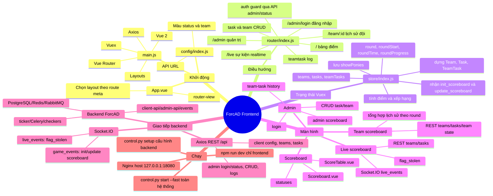
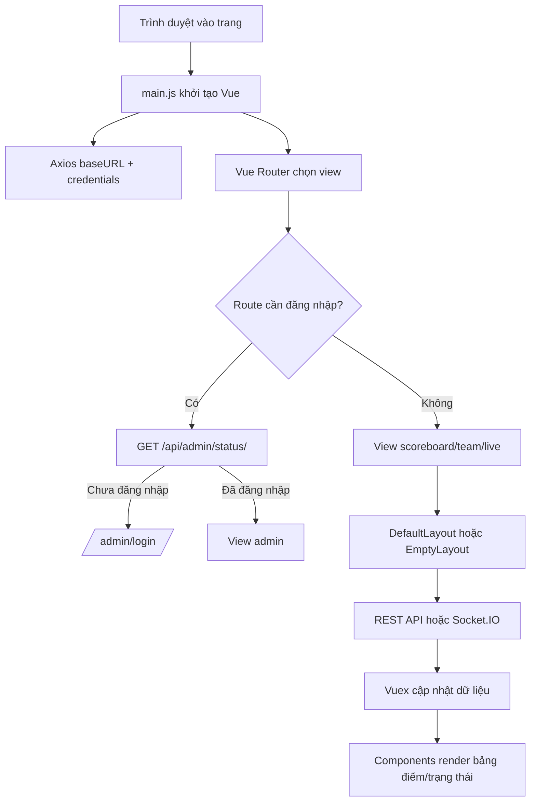
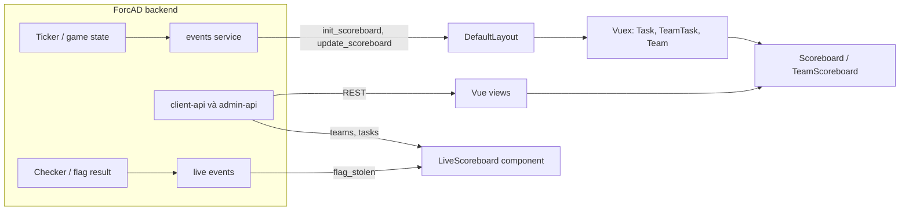

# Mindmap và workflow của `ForcAD-demo/front/src`

Phạm vi đọc mã: toàn bộ `ForcAD-demo/front/src` (33 file), cùng `front/package.json`, `front/vite.config.js`, `docker-compose.yml`, `docker-compose-fast.yml`, `cli/` và cấu hình Nginx để xác định cách chạy thực tế.

## 1. Mindmap



## 2. Workflow lúc mở trang



## 3. Workflow dữ liệu realtime



## 4. Cấu trúc mã nguồn theo trách nhiệm

- `main.js`, `App.vue`: điểm vào SPA; gắn Router, Vuex, Axios; chọn layout theo route.
- `router/index.js`: khai báo route và kiểm tra phiên admin trước khi vào route có `meta.auth`.
- `store/index.js`: trạng thái round, team, task và các mutation/action để biến payload realtime thành model.
- `config/index.js`: backend URL, status code và màu. Khi `import.meta.env.DEV`, backend hiện được hard-code là `http://127.0.0.1:8080`; production dùng `window.location.origin`.
- `models/`: chuẩn hóa `Task`, `Team`, `TeamTask`; tính tổng điểm, SLA, trạng thái và sắp thứ hạng.
- `views/`: các trang ứng với route: scoreboard, live, team, đăng nhập/quản trị.
- `components/Scores/`: bảng điểm chung, bảng theo đội và bảng sự kiện cướp cờ.
- `components/Admin/`: scoreboard admin, form task/team, lịch sử trạng thái của cặp team-task.
- `components/General/`: topbar, tiến độ tick, chú giải trạng thái.
- `components/Lib/`: bảng, khung form, thông báo lỗi và container dùng lại.
- `layouts/DefaultLayout.vue`: kết nối socket `game_events` và nhận `init_scoreboard` / `update_scoreboard`.
- `layouts/EmptyLayout.vue`: layout tối giản dùng cho route live.
- `utils/colors.js`, `assets/table.scss`: trình bày màu trạng thái và kiểu bảng.

### Các route chính

| URL | Màn hình | Backend chính |
|---|---|---|
| `/` | Scoreboard | Socket `game_events` |
| `/live/` | Bảng sự kiện live | REST teams/tasks và socket `live_events` |
| `/team/:id/` | Lịch sử/điểm từng đội | REST client teams/tasks/team state |
| `/admin/login/` | Đăng nhập admin | REST `admin/login/` |
| `/admin/`, `/admin/task/:id/`, `/admin/team/:id/` | Quản trị scoreboard/task/team | REST admin API; có auth guard |
| `/admin/teamtask_log/team/:teamId/task/:taskId/` | Log checker theo đội và task | REST admin teamtasks/teams/tasks |

## 5. Lệnh chạy

### A. Chạy cả hệ thống demo (khuyến nghị)

Mở PowerShell tại thư mục `ForcAD-demo`:

```powershell
cd D:\TAILIEU\LVTN\MEKOSHARING\ForcAD-demo
cd front
npm install
npm run build
cd ..
python -m pip install -r cli\requirements.txt
python control.py setup
python control.py start --fast
```

Build frontend trước để cập nhật `front/dist`, vì service Nginx phục vụ bundle từ thư mục này. Sau khi các container khởi động, mở:

- Bảng điểm: `http://127.0.0.1:18080/`
- Admin: `http://127.0.0.1:18080/admin/`
- Flower: `http://127.0.0.1:18080/flower/`

Lệnh xem log initializer:

```powershell
python control.py rd logs -f initializer
```

Nếu vừa thay đổi backend/base image hoặc cần build image đầy đủ, dùng `python control.py start` (bỏ `--fast`). `--fast` dùng compose overlay image dựng sẵn. `setup` đọc `config.yml`, backup config, sinh thông tin storage/admin và tạo `docker-compose-base.yml`.

### B. Chỉ chạy frontend Vite

```powershell
cd D:\TAILIEU\LVTN\MEKOSHARING\ForcAD-demo\front
npm install
npm run dev
```

`npm run dev` chỉ khởi chạy giao diện Vite, không khởi tạo API, database, event socket hay checker. Backend phải chạy riêng.

**Lưu ý cổng:** Compose hiện map Nginx ra `127.0.0.1:18080`, nhưng `front/src/config/index.js` trỏ backend dev đến `127.0.0.1:8080`. Vì vậy, chạy frontend riêng theo đúng trạng thái mã hiện tại sẽ không gọi đúng backend Compose. Có thể mở frontend qua Compose ở `18080` (khuyến nghị), hoặc đồng bộ `serverUrl` trong file config với cổng backend thực tế trước khi dùng Vite dev server.

## 6. Căn cứ của các lệnh và cổng

- `front/package.json`: `dev` chạy Vite; `build` tạo production bundle; `serve` preview bundle.
- `front/src/main.js`: import entry, cài Axios defaults và mount Vue vào `#app`.
- `front/src/config/index.js`: URL API dev `127.0.0.1:8080`, production dùng origin hiện tại.
- `docker-compose.yml`: service `nginx` mount `front/dist` và publish `127.0.0.1:18080:80`.
- `cli/base/setup.py`: `setup` chuẩn bị config, env cho Postgres/Redis/RabbitMQ/admin và sinh compose base.
- `cli/base/start.py`, `cli/utils.py`, `cli/options.py`: `start --fast` chạy Docker Compose với `docker-compose-fast.yml` overlay.
- `README.md` upstream ghi URL `8080`, nhưng cấu hình Compose cụ thể của bản workspace này đặt `18080`; khi chạy bản này hãy theo `docker-compose.yml` và các file `.bat` trong `ForcAD-demo`.

## 7. Mô hình runtime rút gọn

```text
Browser (Vue SPA) -> Nginx :18080
                       |-> /api/client/* -> client-api
                       |-> /api/admin/*  -> admin-api
                       |-> Socket.IO     -> events
                       `-> /              -> static front/dist

ForcAD services -> PostgreSQL + Redis + RabbitMQ
Ticker/Celery/checkers -> round scheduling, service checks, flags and scores
```

